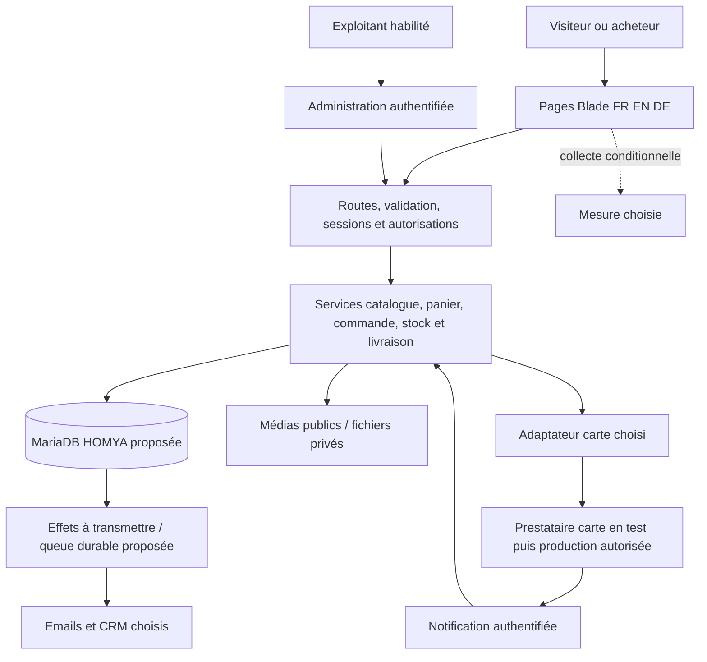

# HOMYA — architecture et plan d’implémentation

**Version 0.1 — 7 octobre 2026 — PROPOSITION, conception uniquement.**

Projet : `/Users/akm/Documents/ChatGPT/HOMYA`. Ce document décrit une cible proportionnée et les conditions de chaque étape. Aucun composant décrit comme prévu n’est considéré comme implémenté. Aucun code, accès, base, migration, service externe ou déploiement n’est autorisé par ce document.

## 1. Références, décisions et portée

- [Cahier des charges v0.1](/Users/akm/Documents/ChatGPT/HOMYA/docs/CAHIER-DES-CHARGES-HOMYA.md) : REQ-001 à REQ-035, AC-001 à AC-035 et PAR-01 à PAR-07 restent les références de traçabilité.
- [Registre canonique Specification](/Users/akm/Codex-Workspace/specification/references/DECISION-AND-CHANGE-LOG.md), section HOMYA : DECISION-001 à DECISION-008 relues. Ce document ne crée pas un second registre général.
- [Cadrage](/Users/akm/Documents/ChatGPT/HOMYA/docs/CADRAGE-HOMYA.md), [environnement local](/Users/akm/Documents/ChatGPT/HOMYA/docs/ENVIRONNEMENT-LOCAL.md), [diagnostic XAMPP](/Users/akm/Documents/ChatGPT/HOMYA/docs/DIAGNOSTIC-XAMPP.md) : observations antérieures, distinguées ci-dessous des nouveaux contrôles.
- Instructions globales/locales et modules consultés : Workflow Master, Specification, E-commerce, Database Engineering, Security, règles UI Laravel, SEO, Analytics, Quality et routeur Deployment. Ils fournissent des méthodes, pas des prix ou règles commerciales HOMYA.

**Point de traçabilité — À confirmer :** la demande actuelle désigne le cahier des charges comme validé. Son fichier porte encore « PROPOSÉ », et aucune entrée d’approbation globale de cette version n’a été retrouvée dans la section HOMYA du registre. Il sert de référence de travail pour cette architecture ; les inconnues qu’il contient restent ouvertes. La portée/version de l’approbation devra être réconciliée dans le registre avant une phase qui en dépend. Cette lacune n’empêche pas la présente proposition et ne justifie aucune réinitialisation du projet.

**Décisions validées à préserver :** dépôt HOMYA, droits déclarés sur DAMDAM dans leur portée publique, travail local avant déploiement, tous les rayons DAMDAM, parcours similaires et identité originale, nouvelle application, Laravel avec MariaDB XAMPP, isolation locale de XAMPP sur 3307 et conservation de MySQL Homebrew. Les pays FR/BE/DE, langues FR/EN/DE, EUR, carte/virement et connexions email/CRM/Google viennent du brief ; leurs modalités ne sont pas fixées automatiquement.

**Statuts :** Fait vérifié ; Décision validée ; Recommandation / Hypothèse ; Inconnu ; À confirmer ; Décision nécessaire ; Bloquante pour une étape identifiée. Toutes les nouvelles options techniques ci-dessous sont des recommandations tant qu’elles ne sont pas acceptées.

## 2. Inspection réelle du 7 octobre 2026

| Élément | Observation et preuve | Limite |
|---|---|---|
| Emplacement et règles | Dépôt confirmé ; AGENTS.md local et global lus ; recherche des règles parentes et de l’arborescence. | Aucun déplacement ni recréation. |
| Git | `main`, aucun commit ; fichiers du projet non suivis. `.env`, `vendor` et `node_modules` ignorés. | Préservation et premier historique à organiser avant modifications applicatives. Aucun commit ici. |
| Backend | `php artisan --version` : Laravel 13.35.0 ; `composer.json` : PHP `^8.3`, Laravel `^13.17` ; verrou et dépendances présents. | Pas de commerce développé. |
| Runtime | PHP CLI Homebrew 8.5.11 ; Composer 2.10.3. PHP XAMPP 8.2.4 contrôlé séparément. | Le PHP Apache XAMPP n’est pas le runtime Laravel à employer. |
| Extensions | PDO MySQL, mbstring, OpenSSL, curl, DOM, XML, fileinfo, intl et extensions contrôlées présentes ; `composer check-platform-reqs` réussi. | Preuve sur ce CLI, aucune preuve sur un hébergement. |
| Frontend | Node 26.8.1, npm 11.19.0 ; verrous : Vite 8.3.3, Tailwind 4.3.3, plugin Laravel 3.2.0. Node satisfait les moteurs déclarés dans le verrou. Manifest Vite présent. | Aucune nouvelle compilation exécutée ; présence du manifest ≠ build de recette. |
| Routes et vues | Racine → `/fr`, accueil `/{locale}` FR/EN/DE ; `/up` déclaré dans bootstrap. Contrôleur Home, composant layout Blade, CSS partagé, traductions `home.php`. | `/up` ne prouve pas la santé du paiement ou de la base. |
| Données | Modèle User et migrations standard users/cache/jobs seulement ; configuration MariaDB spécifique. | Aucun modèle catalogue/commande ni schéma métier vérifié. |
| XAMPP | Socket présent. `homya:db-check` s’arrête avec « Accès local non renseigné ». | Aucune requête SQL applicative atteinte ; base et droits HOMYA non vérifiés. |
| Serveur MariaDB | Diagnostic antérieur : 10.4.28, socket XAMPP, port 3307, boucle locale ; phpMyAdmin fonctionnel après correction. | Identité SQL et interface non retestées dans cette phase. |
| Tests et configuration | Tests existants lus : pages/langues et refus du diagnostic sans connexion. Exemple : sessions/cache fichiers, queue sync, mail log. | Configuration de l’exemple, pas relevé exhaustif du `.env` privé. Aucun test de commerce existant ; tests non relancés ici. |

Les outils MCP claude-code sont annoncés dans cette session. Leur présence ne prouve ni l’authentification Anthropic ni un accès au modèle Claude. Aucun appel de modèle Claude réalisé ; cette phase utilise les capacités natives Codex.

## 3. Questions techniques vérifiées auprès des sources officielles

Questions précises : quels prérequis Laravel 13 imposer au runtime ? MariaDB XAMPP dépasse-t-il le minimum documenté, et est-il encore maintenu ? Une file en base et un traitement borné sont-ils possibles sans ajouter Redis ? Quel référentiel officiel étaye l’objectif d’accessibilité proposé ?

| Source primaire, URL et consultation | Portée / fait publié | Interprétation ou recommandation HOMYA |
|---|---|---|
| [Laravel 13 — Deployment](https://laravel.com/framework/docs/13.x/deployment), consulté le 2026-10-07 | PHP ≥ 8.3 et extensions listées ; racine web `public`, répertoires d’écriture, debug désactivé en production, supervision des processus persistants. | Conserver le PHP CLI actuel localement ; vérifier aussi PHP web et CLI sur l’offre réelle. Pas de preuve d’hébergement. |
| [Laravel 13 — Database: Getting Started](https://laravel.com/framework/docs/13.x/database), consulté le 2026-10-07 | MariaDB 10.3+ annoncé parmi les moteurs pris en charge ; configuration et transactions documentées. | 10.4 dépasse le minimum annoncé. Cela ne vérifie ni le schéma HOMYA ni sa connexion ni sa maintenance. |
| [Laravel 13 — Queues](https://laravel.com/framework/docs/13.x/queues), consulté le 2026-10-07 | Pilote database avec table de jobs ; options après commit et arrêt quand la file est vide. | Proposer une queue en base pour les effets externes ; méthode d’exploitation à choisir selon worker/cron réellement disponibles. |
| [MariaDB — Release Notes, 10.4 Series](https://mariadb.com/docs/release-notes/community-server/old-releases/10.4), consulté le 2026-10-07 | Série 10.4 maintenue jusqu’en juin 2024. | Risque de maintenance identifié. Garder la cible locale demandée pour cette conception ; prévoir une version maintenue en production et une stratégie d’alignement des tests. Aucune mise à niveau XAMPP autorisée ici. |
| [W3C — Web Content Accessibility Guidelines 2.2](https://www.w3.org/TR/WCAG22/), consulté le 2026-10-07 | Recommandation W3C et critères testables, dont niveaux de conformité. | Objectif de recette WCAG 2.2 AA proposé ; ni conformité testée ni applicabilité juridique déduite. |

La page `mariadb.org/about/#maintenance-policy` n’a pas pu être récupérée ; l’information ci-dessus vient de la documentation officielle MariaDB accessible. Aucune politique juridique ni capacité d’une offre d’hébergement n’a été recherchée ou certifiée sans environnement identifié.

## 4. Stack et alternatives

**Recommandation : une application Laravel unique, organisée par fonctions, avec rendu Blade côté serveur.** Elle réutilise le socle, permet des formulaires simples et des pages publiques multilingues, et centralise les règles transactionnelles. REQ-002, REQ-003, REQ-009, REQ-025, REQ-026, REQ-030.

| Couche | Proposition | Justification / condition |
|---|---|---|
| Runtime et framework | Conserver Laravel 13 verrouillé et PHP CLI 8.5 local ; minimum production PHP 8.3 plus exigences effectives du verrou. | Choix Laravel déjà validé ; aucun upgrade ou downgrade requis pour cette phase. |
| UI | Blade, composants existants, CSS partagé/Tailwind et Vite ; JavaScript limité aux interactions utiles. | Cohérent avec les conventions, pas de deuxième frontend à maintenir. Les fonctions essentielles doivent rester accessibles avec formulaires serveur. |
| Persistance | Eloquent et MariaDB XAMPP local ; transactions et tables transactionnelles à confirmer dans le modèle physique. | Cible imposée par l’utilisateur ; aucune substitution Homebrew/SQLite. Production à vérifier. |
| Recherche | Recherche SQL paginée, référence/nom et filtres sur attributs validés. | Volumétrie inconnue : commencer simple, mesurer pertinence/latence avant un moteur externe. Pas de promesse de recherche approximative. |
| Panier | Session serveur comme première option ; références/quantités, recalcul à chaque étape critique. | Évite un compte obligatoire ; persistance longue, multiappareil et fusion dépendront de REQ-023. |
| Administration | Pages Blade dans la même application, authentification session et Policies/Gates côté serveur. | Catalogue/commandes ciblés ; interface et droits distincts des pages publiques. Pas de package d’administration imposé. |
| Effets externes | Adaptateurs carte/email/CRM ; queue database à partir des transactions métier. | Réutilise le moteur ; reprises, échecs et supervision nécessaires avant vente. Pas de Redis requis à ce stade. |
| Fichiers | Médias produits publics séparés des fichiers privés ; abstraction Storage Laravel. | Stockage local persistant proposé pour un serveur unique ; stockage objet seulement si besoin/offre validés. |
| Vérification | PHPUnit existant, Pint, build Vite ; intégration sur MariaDB et revue navigateur des parcours. | Les tests sans base restent utiles mais ne vérifient pas les contraintes/concurrences SQL. |

**Alternatives non retenues comme base :** SPA/headless et API séparée ajoutent un frontend, une gestion d’authentification et des contrats sans besoin confirmé ; Livewire pourra être évalué pour une interaction qui le justifie ; moteur de recherche/Redis et services séparés après mesures ; plateforme e-commerce packagée à comparer seulement si la gestion standard ou le budget rendent cette voie préférable. Une telle bascule demanderait une étude officielle des versions, extensions, licences et une nouvelle validation, car elle change le socle Laravel confirmé. Aucune compatibilité de package non installé n’est annoncée.

## 5. Schéma fonctionnel et frontières techniques

Schéma **proposé**, sans services nouvellement démarrés :



Local : navigateur → serveur de développement Laravel avec PHP 8.5 → socket MariaDB XAMPP, distinct du serveur Homebrew sur 3306. Apache XAMPP dessert phpMyAdmin séparément. Production : serveur HTTP avec PHP compatible → `public/index.php`, base privée, stockage persistant et exécuteur de tâches vérifiés. Le serveur de développement Laravel et l’installation XAMPP actuelle ne constituent pas une cible de production.

## 6. Pages, composants et services prévus

| Zone / parcours | Pages proposées et composants | Services / exigences |
|---|---|---|
| PAR-01 découverte | Accueil, univers/catégorie, recherche paginée ; navigation, changement de langue, carte produit, filtres, fil d’Ariane, état vide. | Catalogue et recherche ; REQ-001 à REQ-006. |
| PAR-02 choix/panier | Produit, variantes/conditionnement, panier ; galerie, caractéristiques, quantité, montant et messages de disponibilité. | Produit, panier, calcul et disponibilité ; REQ-006 à REQ-010. |
| PAR-03/PAR-04 commande | Coordonnées, destination, livraison, récapitulatif, choix carte/virement, retour de paiement et confirmation. Une même logique serveur pour les deux moyens. | Commande, calcul, livraison, paiement, stock ; REQ-009 à REQ-016, REQ-021. |
| PAR-05 après achat | Accès protégé au suivi, contact/SAV ; états de commande et formulaire de demande selon règles retenues. | Suivi, notifications, traitement des demandes ; REQ-017, REQ-018, REQ-021. |
| PAR-06 exploitation | Connexion, liste/édition catalogue, publication, liste/détail commandes, rapprochement autorisé et journal des actions. | Administration, permissions, publication, états ; REQ-019, REQ-020, REQ-025. |
| PAR-07 conditionnel | Compte, récupération, adresses et historique si retenus. | Authentification et accès aux seules ressources autorisées ; REQ-023 à REQ-025. |
| Informations | Livraison/retours, contact, présentation, documents approuvés ; métadonnées, erreurs de formulaire et alertes partagées. | Contenus et traitements ; REQ-018, REQ-024, REQ-026, REQ-033. |

Conserver le layout et les tokens visuels existants comme point de départ réversible ; leur présence n’est pas une validation définitive de charte. Proposer des composants bouton/champ/erreur/alerte/carte/pagination et éviter la logique financière dans les vues. Aucun avis, prix, délai ou badge commercial fabriqué.

**Découpage applicatif recommandé :** contrôleurs fins ; Form Requests pour validation ; Policies pour droits ; services de catalogue/panier, calcul, commande/états, disponibilité, livraison et paiement. Adaptateur de paiement à définir avec le prestataire, mail Laravel pour les notifications, adaptateur CRM seulement après choix du flux. Ajouter une abstraction lorsqu’une frontière réelle la justifie, pas une couche générique pour chaque modèle.

## 7. Données proposées et intégrité

Il s’agit d’une carte de concepts **Hypothèse**, pas d’un MCD/MLD validé ni d’un schéma physique. Cardinalités, nullabilité, types et droits de suppression restent à arrêter avec les sources métier. Le MCD sera revu avant sa traduction en MLD, puis en migrations distinctement autorisées.

| Concepts | Relations et usage proposés | Inconnues / contrôle attendu |
|---|---|---|
| Catégorie, produit, unité vendable/variante | Classement, référence, unité/conditionnement ; une variante simple éventuelle évite deux logiques de commande. | Relations produit/catégorie et variantes par famille à confirmer ; REQ-001, REQ-007. |
| Traduction, média, provenance | Contenus liés à un produit/catégorie et langue ; métadonnées et origine d’actif. | Politique de traduction manquante et publication à décider ; pas de faux contenu traduit. REQ-003, REQ-006. |
| Prix, disponibilité et éventuel mouvement/réservation | Source de prix/stock liée à l’unité vendable ; mouvements seulement si stock géré dans HOMYA. | Stock propre ou fournisseur, conversions et fréquence inconnus ; aucun registre de stock fictif. REQ-009, REQ-010. |
| Panier | Sélection de références et quantités liée à une session ; identité client seulement si retenue. | Persistance, expiration et fusion à décider ; prix serveur revalidé. REQ-008, REQ-023. |
| Commande et ligne historique | Référence, coordonnées nécessaires, adresse, lignes et montants figés selon règles approuvées ; liens au catalogue sans dépendance exclusive. | Conservation, fiscalité, arrondis, états et transitions ; REQ-009, REQ-012, REQ-016, REQ-024. |
| Tentative de paiement / événement reçu | Référence commande, fournisseur, référence externe, montant/devise/état utile ; distinction tentative, succès et remboursement. | Contrat prestataire ; unicité et traitement du rejeu ; aucune donnée carte brute. REQ-013 à REQ-015. |
| Livraison/suivi et demandes SAV | Informations opérationnelles liées à une commande. | Modèle logistique et sources non connus ; historique minimal nécessaire. REQ-011, REQ-017, REQ-018. |
| Utilisateur, droits, journal d’action | Comptes exploitants ; lien client optionnel ; actions sensibles auditées. | Matrice, personnes et conservation ; pas de super-administrateur implicite. REQ-020, REQ-023 à REQ-025. |
| Effet à transmettre, job, échec de transmission | Notification métier durable puis exécution/reprise vers email/CRM. | Éviter la perte entre commit et enqueue ; destinataires et reprises à définir. REQ-015, REQ-021, REQ-022, REQ-029. |

**Intégrité proposée :** valeurs monétaires exactes, jamais flottants binaires pour les montants critiques ; représentation finale centimes/décimal et règles d’arrondi selon unités/taxes approuvées. EUR conservé explicitement. Quantités entières ou décimales selon conditionnements validés. Stock et commande traités atomiquement, identifiants d’idempotence uniques, vérifications de montants/devise et clés étrangères adaptées à l’historique. Ne pas supprimer une ligne historique quand un produit sort du catalogue. Les suppressions/archivages et la rétention ne sont pas décidés par commodité technique.

Requêtes à dimensionner : listing par catégorie/publication/langue ; recherche référence/nom ; commandes par état/date ; unicité des références et événements prestataire. Index candidats justifiés par ces requêtes, à arrêter dans le MLD et vérifier avec plans SQL sur données représentatives. Pas de volume ou seuil de performance inventé. Collations multilingues, décimaux, JSON éventuel, contraintes et verrous seront testés sur MariaDB ; SQLite ne servira pas de preuve de portabilité. Aucun JSON pour remplacer sans justification les données critiques relationnelles.

## 8. Rôles et permissions

| Rôle proposé | Accès recommandé | Points ouverts |
|---|---|---|
| Visiteur / acheteur invité | Catalogue, sa session/panier et suivi obtenu par une méthode protégée. | Achat invité à approuver ; lien de suivi secret/sécurisé avec expiration et récupération à définir. |
| Client si retenu | Ses commandes, profil et adresses seulement. | Compte facultatif/obligatoire, récupération et vérification. |
| Exploitant catalogue | Contenus, médias et publication ; prix/stock seulement si habilité. | Source faisant autorité et droits de publication. |
| Exploitant commandes / support | Lecture utile et transitions expressément autorisées. | Accès aux coordonnées, retours, exports. |
| Rapprochement financier | Vérification virement ; remboursement seulement si droit distinct approuvé. | Responsables, justificatifs et procédure. |
| Administration technique | Maintenance et gestion d’accès dans la portée acceptée. | Aucun droit financier automatique. |

Ces rôles fonctionnels ne sont pas des personnes déjà nommées ni des tables imposées. Une matrice finale action × ressource × rôle précédera l’authentification complète et l’administration. Contrôles serveur sur chaque action et chaque commande ; masquer un bouton ne suffit pas. REQ-019, REQ-020, REQ-023, REQ-025.

## 9. Flux critiques et erreurs

**Catalogue → panier :** lire un produit publiable, vérifier unité/quantité, stock selon règle choisie ; garder références et quantités ; recalculer au serveur. Toute donnée de vente inconnue empêche l’achat concerné plutôt que de créer une promesse. Catalogue vide, absence de résultat, traduction/média manquant et produit retiré ont un message et une issue explicites.

**Commande → carte :** revalider panier/destination/montants ; créer de façon idempotente une commande et l’intention de stock prévue, dans une transaction courte. Appeler le prestataire après commit, avec référence et clé d’idempotence. Une erreur réseau après l’appel laisse un résultat incertain à rapprocher ; réutiliser la référence et consulter le fournisseur avant de recommencer. La redirection navigateur sert à l’information, pas à confirmer le paiement. La notification authentifiée est persistée/dédupliquée et rapprochée avec montant, devise, référence et état attendu. Appliquer un effet de stock/commande une seule fois, puis produire les notifications durables. Pas de transaction SQL maintenue ouverte pendant un appel externe.

**Virement :** recevoir une commande distincte d’un paiement reçu, émettre les instructions validées ; rapprochement par un opérateur habilité et traçable. Montant partiel/excédent, doublon, absence de paiement ou échéance doivent suivre une procédure approuvée. Aucune durée de réservation ou annulation automatique choisie ici.

**États proposés à discuter :** axes séparés pour commande, paiement et exécution logistique. « Attente de paiement », « paiement confirmé », « en préparation » et « expédiée » sont des exemples d’écrans, pas une matrice métier validée. Échec/annulation d’une tentative ne signifie pas automatiquement annulation de la commande. Remboursement partiel/total ne restaure pas automatiquement le stock ni n’atteste un retour physique. Événements tardifs/désordonnés et paiement reçu après expiration imposent un rapprochement et une règle métier avant automatisation.

| Erreur ou incident | Réponse prévue / contrôle de recette |
|---|---|
| Panier vide, quantité invalide, prix changé ou rupture | Message contextualisé, récapitulatif recalculé, correction avant nouvel engagement ; AC-008 à AC-010. |
| Destination non desservie / frais non déterminables | Achat bloqué pour cette destination avant appel paiement ; aucune livraison offerte par défaut ; AC-011, AC-012. |
| Session expirée / données invalides | Reconnexion ou reprise sûre, erreurs accessibles ; préserver seulement les informations autorisées ; AC-012, AC-024, AC-025. |
| Carte refusée, abandon, retour avant notification | Affichage du résultat confirmé ou « confirmation en cours » ; possibilité de reprise sans doubler les effets ; AC-013, AC-015. |
| Webhook invalide, doublon ou résultat contradictoire | Refus/absence de mutation pour l’invalide ; aucun second effet pour le doublon ; rapprochement pour le contradictoire ; AC-015, AC-016. |
| Paiement confirmé mais persistance/transmission en panne | Reprise à partir des événements et références, alerte exploitant ; nouvelle vérification fournisseur selon contrat ; pas de demande de second paiement automatique ; AC-015, AC-021, AC-029. |
| Email/CRM indisponible | Commande conservée, effet durable en attente/échec visible, reprise contrôlée ; envoi physique exactement une fois non garanti sans contrat fournisseur ; AC-021, AC-022. |
| Suivi inconnu/non autorisé | Réponse neutre sans données d’une autre commande ni énumération ; AC-017, AC-020. |
| Base indisponible ou conflit concurrent | Erreur récupérable sans afficher SQL/secrets ; aucune commande réputée confirmée sans persistance ; test d’atomicité et concurrence ; AC-010, AC-025. |

## 10. Intégrations, SEO et mesure

**Carte :** recommander une interface hébergée par un fournisseur pour éviter de faire transiter les données carte brutes par HOMYA. Fournisseur non choisi ; vérifier pays, contrat, devise, méthodes, notifications, remboursements et mode test dans ses sources officielles avant intégration. Aucun SDK, tarif ou compte supposé. REQ-013 à REQ-015.

**Email :** garder les essais sans envoi réel ; avant exploitation vérifier domaine d’envoi, fournisseur, authentification du domaine, destinataires, traductions, liens protégés, reprises et limites. Les logs de mail peuvent contenir des données personnelles : employer des fixtures de recette et définir l’expurgation/conservation. **CRM :** finalités/champs/fréquence et sens des échanges avant produit ou connexion ; accès minimal, déduplication et erreur visible. Brevo n’est pas choisi. **Transport :** saisie manuelle initiale comme option réversible si acceptable ; API seulement après modèle d’exploitation. REQ-017, REQ-021, REQ-022, REQ-024.

**SEO proposé — REQ-026 :** URLs localisées sous `/fr`, `/en`, `/de`, identifiants stables et slugs de contenu ; convention exacte à arrêter avant publication. Langue et pays de livraison restent deux paramètres différents. Métadonnées et headings par page ; canonicals cohérents, variantes linguistiques seulement pour contenus réellement disponibles ; sitemap des pages publiables. Recherche/filtres, panier, checkout, comptes et administration exclus de la stratégie d’indexation selon revue SEO. Une page authentifiée reste protégée par ses droits, pas par robots. Prix/disponibilité des éventuelles données structurées issus des mêmes données que la page, sans avis ni offre fictive. Local/préproduction protégés et non indexables ; ouverture publique séparément approuvée. Redirections à préparer si une URL publique change.

**Mesure conditionnelle — REQ-027 :** préparer un catalogue d’événements et finalités avant tout outil. Produit/panier/checkout reflètent l’action réelle ; événement d’achat fondé sur le paiement confirmé, avec distinction commande reçue et virement reçu. Définition fiscale de la valeur et gestion des remboursements à valider. Un identifiant métier permet la déduplication ; la base de commandes rapprochée reste la source des ventes. Aucun email/adresse/secret dans les événements. Données autorisées, mécanisme de choix/consentement et destinations définis après analyse des traitements. Un navigateur revenu ne garantit pas la mesure de tous les virements différés : couvrir ce cas selon le fournisseur retenu, en décrivant les limites. Pas de GA4/GTM injecté par défaut ni de cible KPI inventée.

**Google — REQ-028 :** Search pour les pages publiques ; Search Console selon domaine et propriété ; données produit et Merchant/Free Listings/Shopping selon offres, pays et règles à vérifier ; GA4/GTM selon plan de mesure ; Ads/PMax selon objectif et budget autorisés ; Business Profile et Local Inventory selon activité physique vérifiée. Chaque service reste **Non évalué pour la cible**, hormis les observations du prototype, et aucune préparation n’atteste une acceptation Google. Flux produits éventuel dérivé de la source catalogue, jamais d’un catalogue concurrent parallèle. Politiques actuelles à examiner seulement pour les services retenus.

## 11. Sécurité, accessibilité et exploitation

**Menaces à traiter, sans constat de vulnérabilité actuelle :** modification d’un total navigateur, accès à une commande tierce, élévation de droits, rejeu/falsification de paiement, achats concurrents, upload exécutable, fuite dans logs/URLs et panne d’une intégration. Frontières de confiance : navigateur, back-office, base, fichiers et chaque fournisseur.

Contrôles proposés : validation serveur et requêtes paramétrées, échappement Blade et politique de contenu riche, CSRF sur formulaires, exceptions limitées aux notifications authentifiées, limitation des tentatives d’accès, sessions régénérées et cookies sécurisés en HTTPS, Policies et droits minimaux, MFA administration recommandée avant données réelles. Médias vérifiés par contenu/type/taille, noms générés et fichiers privés hors racine publique ; téléchargements autorisés. Secrets hors Git/logs/vues, debug désactivé en production, base non publique et compte applicatif aux droits nécessaires. Les droits de migration seront distincts lorsque l’exploitation l’exige. Paramètres exacts après offre/providers et matrice de rôles. REQ-020, REQ-024, REQ-025.

**Accessibilité / performance — REQ-004, REQ-032 :** HTML sémantique, libellés, focus, navigation clavier, messages de formulaire annoncés, contraste et états chargement/erreur/vide. Recommander WCAG 2.2 AA comme objectif de recette, à confirmer ; ce choix ne tranche pas les obligations juridiques. Budget de poids/latence et configurations de recette à définir sur médias/catalogue réels. Pagination, chargement des relations utile, dimensions d’images, variantes adaptées et cache des contenus publics ; éviter le cache partagé de panier/commande. Mesurer avant optimisation supplémentaire, sans promesse chiffrée.

**Sauvegardes — REQ-029 :** inclure base, médias, fichiers privés nécessaires, configuration protégée et secrets de chiffrement indispensables à une restauration. Sauvegarde cohérente des données et fichiers, copie hors environnement, chiffrement/accès limités, politique de durée/suppression validée. Fréquence, perte acceptable (RPO) et temps de reprise (RTO) inconnus. Tester la restauration dans un environnement isolé sans emails, callbacks ni effets financiers ; rapprocher les paiements fournisseur postérieurs au point restauré. Git ne sauvegarde ni la base ni les secrets. Aucun backup/restore exécuté ici ; les sauvegardes de configuration XAMPP antérieures ne couvrent pas les données HOMYA.

**Exploitation :** corrélation commande/tentative/événement avec références non secrètes ; journal d’audit distinct des logs de debug, minimisés et à accès restreint. Suivre erreurs checkout, paiements incertains, échecs et ancienneté de queue, sauvegardes et disponibilité. `/up` actuel = démarrage applicatif ; contrôles base/queue/fournisseurs à préparer séparément sans endpoint public divulguant la configuration. Responsable d’incident et canaux à désigner. Une panne commande/paiement peut nécessiter de suspendre les nouveaux achats, puis de rapprocher les transactions avant reprise. Aucune alerte externe/automatisation créée.

**Juridictions — REQ-024, REQ-033 :** FR/BE/DE et cadre européen à examiner selon établissement du vendeur, B2C/B2B, produits, expéditions et destinataires réels. Collecte, conservation, documents de vente, langues et consentements devront être revus sur sources officielles actuelles lorsque ces faits sont fournis. Aucun délai légal, taxe ou obligation particulière fixé ici ; les interprétations complexes/étrangères et les textes à enjeu devront être confirmés par un professionnel compétent. Cette architecture ne certifie pas la conformité.

## 12. Hébergement : décision ouverte et grille de capacités

**Inconnu :** fournisseur, formule, accès, budget, domaine et responsable d’exploitation. Hostinger n’est pas sélectionné ni évalué comme offre réelle. Pas de recommandation d’achat à ce stade ; la cible proposée ne présume aucune capacité commerciale.

| Capacité à vérifier avant choix | Besoin proposé / preuve attendue |
|---|---|
| Runtime web et CLI | PHP compatible avec le verrou, extensions requises, options mémoire/temps ; documentation actuelle de la formule puis preuve environnement. |
| Base | Moteur/version maintenue, transactions/verrous/contraintes, droits, limites connexions/stockage et accès privé ; compatibilité distincte si MySQL est proposé à la place de MariaDB. |
| Tâches | Worker supervisé recommandé pour effets externes ; sinon cron + exécutions bornées/non concurrentes à éprouver, avec latence et limites acceptées. Si aucun mécanisme fiable : offre inadaptée au plan transactionnel. |
| Stockage | Persistance, espace, inodes, upload, séparation public/privé, permissions et éventuels liens ; stockage objet seulement si nécessaire. |
| Email | SMTP/API sortants, limites et authentification domaine, journaux et reprises ; ne pas supposer boîte email incluse. |
| Ressources | CPU/RAM/processus/concurrence/I/O ; capacité mesurée sur profils et catalogue réels, pas une promesse de trafic. |
| Build et déploiement | Racine web `public`, CLI/SSH ou mécanisme équivalent sûr, artefacts Composer/Vite reproductibles, migrations contrôlées, redémarrage tâches, version précédente récupérable. Node peut rester dans l’environnement de build. |
| Domaine et SSL | Domaine, DNS, HTTPS, renouvellement, URLs de callbacks et séparation préproduction/production. Achat et publication soumis à autorisation. |
| Sauvegarde et reprise | Portée réelle, fréquences, rétention, restauration/export, contrôle d’accès et responsabilités ; test de restauration. |
| Exploitation et données | Logs, alertes, localisation/sous-traitance et accès aux incidents ; preuves contractuelles si nécessaires. |

Une offre mutualisée avec cron peut être une candidate seulement si ces limites passent la recette ; un environnement géré ou serveur avec processus supervisés peut répondre au besoin de worker, mais ni coût ni exploitation ne sont supposés. Aucune offre précise n’est retenue. Lorsqu’une candidate sera fournie, compléter cette grille avec titre/URL/date/portée des documents officiels et preuve d’accès réel pour les points nécessaires. REQ-031 reste ouvert jusqu’à cette vérification.

## 13. Structure prévue — aucun fichier applicatif créé

```text
app/
  Http/Controllers/       public, checkout, suivi ; Admin/ selon besoin
  Http/Requests/          validation des entrées
  Models/                après MCD et MLD acceptés ; User conservé
  Policies/              droits serveur
  Services/              Catalogue, Cart, Orders, Stock, Shipping, Payments
  Integrations/          adaptateurs uniquement pour fournisseurs retenus
  Jobs/ et Mail/         effets externes, reprises et messages
resources/views/
  components/            layout existant, champs, alertes, cartes, pagination
  catalog/, cart/, checkout/, orders/, admin/, pages/
  account/               seulement si retenu
resources/css/ et js/    entrées Vite et styles partagés conservés
lang/fr/, en/, de/       textes d’interface ; contenus métier séparés
routes/web.php           groupes localisés et administration protégée
routes/console.php       tâches explicitement retenues
config/                 fournisseur et exploitation, sans secrets
database/migrations/    uniquement après modèle et autorisation propres
tests/                  unitaires, feature et intégration MariaDB séparées
docs/                   sources, architecture, modèles et preuves de recette
```

Les noms sont indicatifs et réversibles ; ne créer un sous-dossier que pour une responsabilité effectivement développée. Préserver les composants existants, les verrous, les protections du diagnostic et la configuration XAMPP. `.env` reste privé. Le plan d’une phase désignera les fichiers exacts avant modification.

## 14. Plan par dépendances et contrôles de sortie

Étapes **proposées**, sans dates, charge, budget ni réduction automatique des rayons validés. Le premier lot peut rester une tranche locale vérifiable sans paiement réel. Chaque critère applicable du cahier devra obtenir une preuve ; la colonne ci-dessous indique les contrôles déterminants, pas toute la recette.

| Étape | Livrable futur / périmètre | Conditions d’entrée | Contrôles et sortie |
|---|---|---|---|
| 0 — Arbitrages et modèles | Réconcilier approbation documentaire, source catalogue, unités/variantes, prix/stock, rôles ; MCD puis MLD ; matrice d’états/transactions. | Acceptation de l’architecture proposée ; responsables métier. | Modèles sourcés et revus ; inconnues localisées ; REQ-001, REQ-007, REQ-009 à REQ-011, REQ-020, REQ-023, REQ-024. Aucun code ni migration implicites. |
| 1 — Base locale isolée | Plan de création/vérification des bases locale/test et comptes à droits nécessaires ; puis schéma minimum du lot autorisé. | MLD du lot approuvé ; absence de collision et autorisation explicite distincte pour base/comptes/migrations. | Identité XAMPP, accès, contraintes et séparation test/local vérifiés ; AC-030. Tests ne ciblant jamais par défaut une base métier ; contrôle/refus des cibles impropres. |
| 2 — Catalogue et interface | Catégories, unités vendables, traductions et médias ; administration de publication minimale ; accueil/catalogue/produit/recherche. | Source et échantillon réel approuvés par famille ; rôles catalogue ; autorisation de code du lot. | AC-001 à AC-007, AC-019, AC-020, AC-026 ; FR/EN/DE, états vides, clavier/mobile. Publication sans donnée commerciale inventée. |
| 3 — Panier et commande locale | Panier, calculs/destination, commande historique, contrôle de stock et suivi protégé. | Règles de calcul/livraison/concurrence et achat invité/compte choisis ; compte client inclus seulement s’il est nécessaire à ce lot. | AC-008 à AC-012, AC-016, AC-017, AC-023 à AC-025 ; altération des montants, achat concurrent, double soumission, transition interdite. Aucune preuve de paiement réel. |
| 4 — Transactions en test | Carte via fournisseur retenu, procédure virement, rapprochement, queue et emails de test ; administration du traitement. | Prestataire/accès de test, états et politique de réservation/remboursement, opérateurs, canal sans envoi réel autorisé. | AC-013 à AC-016, AC-019 à AC-021 ; refus, abandon, rejeu, événement tardif, résultat incertain, reprise après panne. Contacts et SAV selon règles AC-018. |
| 5 — Intégrations conditionnelles | CRM, mesure et services Google retenus ; promotions/avis seulement si acceptés. | Finalités/données/rétention, choix des outils et règles actuelles vérifiées ; autorisations propres aux essais externes. | AC-022, AC-024, AC-027, AC-028, AC-035 si applicables ; erreurs de transmission et déduplication, valeurs rapprochées aux commandes, absence de données personnelles inutiles. |
| 6 — Préproduction et recette | Offre réellement compatible, traductions/documents approuvés, sauvegarde/restauration, préparation de livraison. | Offre/domaines sélectionnés et vérifiés ; règles juridiques/métier et responsables établis ; autorisations d’environnement. | AC-004, AC-025, AC-026, AC-029, AC-031 à AC-034 et tous les parcours retenus ; build/tests/revue navigateur, moteur production, restauration isolée, reprise de paiements et supervision. |
| 7 — Publication distincte | Déploiement contrôlé, migrations approuvées, HTTPS, indexation, canaux réels et surveillance. | Recette documentée sans blocage critique, offre et procédure validées, accord explicite de déploiement/actions réelles. | Smoke checks, rapprochement et supervision ; possibilité de revenir à une release compatible. Aucun rollback de données destructif promis. |

Séquence critique : données et règles → modèle → base isolée → catalogue → calcul/commande → paiements fiables → recette → lancement. UX, sécurité et SEO accompagnent les lots ; CRM/Google/mesure n’empêchent pas la conception du catalogue lorsqu’aucun flux retenu n’en dépend. Les objectifs juridiques et de collecte doivent être résolus avant les traitements concernés, pas seulement au dernier lot.

**Méthode de validation future :** tests unitaires des calculs/règles, feature des droits et parcours, intégration des contraintes/verrous sur MariaDB, contrats du fournisseur en test, puis navigateur pour mobile/clavier et reprise de checkout. Prévoir restauration et panne au milieu d’une confirmation de paiement. PHPUnit/Pint/build ne prouvent pas à eux seuls le fonctionnement du commerce. Les tests de base nécessitent un environnement séparé autorisé ; aucun `migrate:fresh` sur une cible HOMYA existante ou sur production.

## 15. Risques, décisions ouvertes et demande de validation

| Risque / décision ouverte | Étape affectée | Réponse proposée |
|---|---|---|
| Approbation CDC non retrouvée dans le registre ; architecture non approuvée | Avant modèles/implémentation fondés sur ces accords | Consigner portée et version exactes dans le registre unique après confirmation ; aucune inconnue considérée réglée. |
| Catalogue/source des prix/stocks, unités et approvisionnement inconnus | Modèle et lots 2–4 | Obtenir des fiches réelles de chaque famille et source de vérité ; ne pas importer automatiquement les promesses DAMDAM. |
| Accès/base HOMYA non préparés | Lot 1 | Plan d’isolation, contrôle de collision et autorisation propres ; aucun usage silencieux du service Homebrew. |
| XAMPP MariaDB 10.4 hors maintenance ; PHP XAMPP inférieur au minimum Laravel | Local et futur hébergement | PHP CLI compatible ; environnement local non exposé ; évolution DB et alignement de recette à planifier séparément avant données réelles/production. |
| Calculs, stock, livraison, virements et états inconnus | Lots 3–4 | Faire approuver les invariants ; tests concurrents et idempotence ; aucune règle commerciale par défaut. |
| Paiement réussi mais notification/persistance retardée | Lot 4 / exploitation | Événements durables, rapprochement prestataire, contrôle des doubles effets et procédures de reprise. |
| Comptes et rôles non décidés | Modèle, checkout, administration | Achat invité recommandé avec compte facultatif ultérieur comme option ; matrice des permissions indispensable. |
| Prestataires, traitements et documents non définis | Intégrations/collecte/lancement | Cartographie, sources officielles propres au modèle et validation des textes ; pas de données de production dans les essais. |
| Hébergement et objectifs de reprise/performance inconnus | Lot 6 | Grille officielle + preuve environnement + mesures ; aucune compatibilité ou capacité certifiée. |
| Aucun historique Git | Avant premières modifications applicatives | Organiser une sauvegarde/version initiale en préservant secrets et fichiers actuels ; pas de commit réalisé ici. |

**Choix structurants soumis maintenant :** accepter comme architecture de référence Laravel unique + Blade/Vite/Tailwind, MariaDB XAMPP local, services métier, administration protégée, adaptateurs fournisseurs et queue en base quand les fonctions transactionnelles arrivent. Ce choix porte sur la conception et l’ordre des lots, pas sur une offre d’hébergement ni un droit de coder.

**Questions métier à traiter avant le modèle du premier lot :** quelle source fait autorité pour les références/prix/stocks et quelles unités/variantes par famille ? Quel approvisionnement (stock propre/fournisseur/autre) ? Qui publie et exploite ? La réponse peut être limitée au premier échantillon local, sans réduire le périmètre global des rayons.

**Arbitrages à leur échéance :** avant checkout, identité vendeur et B2C/B2B, compte invité/facultatif/obligatoire, calculs et livraison ; avant paiement, fournisseur, virement, réservation, transitions et remboursements ; avant collecte/intégrations, finalités et rétention ; avant production, hébergement/domaine, responsabilité d’exploitation et objectifs de reprise/performance. Les choix visuels et noms de dossiers réversibles ne demandent pas une validation structurante supplémentaire.

## 16. Contrôles effectivement réalisés pour cette version

Lecture du dépôt et des conventions, du cahier, des huit décisions et des instructions ; versions runtime et verrous ; routes déclarées ; extensions ; exigences plateforme Composer ; refus sécurisé du diagnostic base avant SQL ; présence du socket et du manifest Vite ; état Git et exclusions des fichiers privés. Recherches officielles limitées aux questions de la section 3.

Contrôles documentaires réalisés après rédaction : références REQ/AC/PAR présentes dans le cahier des charges, cinq liens locaux existants, seize sections séquentielles et tables cohérentes. Empreintes comparées : les 46 fichiers applicatifs et conventions sélectionnés avant rédaction sont inchangés, hors secrets et fichiers runtime. Ces contrôles ne constituent pas une recette de l’application ni un rendu navigateur du schéma.

**Non exécutés :** code, installation, mise à jour, build/test applicatif, connexion SQL HOMYA, création de base/compte, migration, nouvel essai phpMyAdmin, paiement, envoi, import, sauvegarde/restauration de données, modification XAMPP, commit, connexion Google/CRM, achat ou publication. La proposition est prête pour revue documentaire ; elle n’est pas une architecture approuvée ni une preuve de boutique opérationnelle.
