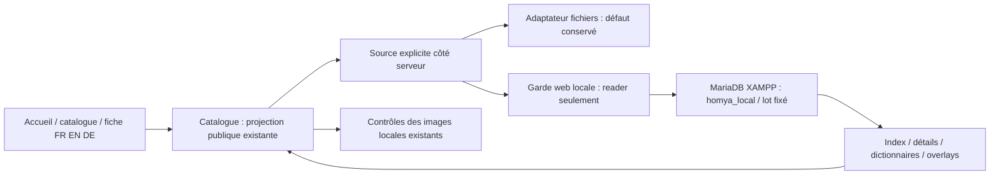

# HOMYA — OP-10, raccordement du catalogue public à SQL

Version 0.2 — 08/10/2026 — **ADAPTATEURS ET TESTS HORS BASE LIVRÉS ; SOURCE FICHIERS CONSERVÉE**.

La v0.1 validée est [figée ici](../output/qa-import/op10-plan-valide-v01.md). Les sections1–8 conservent la proposition et les constats de cette première phase ; la section9 décrit l’état actuel et remplace les mentions d’autorisation future regroupant recette et bascule. DECISION-042 autorise uniquement le développement/tests hors base. **Recette native en lecture seule et bascule nécessiteront chacune leur autorisation distincte.**

Demande reçue : préparer OP-10 pour relier le site au catalogue SQL. Cette préparation couvre inspection des fichiers, analyse et plan. Elle ne prolonge pas l'autorisation OP-09 vers un accès web, un nouveau contrôle SQL ou une activation. Le site actuel conserve la lecture fichiers.

## 1. Faits, sources et limites

| Qualification | Constat | Source / limite |
|---|---|---|
| Décision validée | Laravel, MariaDB XAMPP locale, FR/EN/DE, catalogue consultatif non vendable ; bascule séparée après recette | Registre central HOMYA, notamment DECISION-017/018/019/041 ; [IMP-09/10](PLAN-IMPORT-XAMPP.md) |
| Fait vérifié à OP-09 | `homya_local` : lot vérifié, 65 catégories, 3 709 produits, 23 878 traductions ; quatre lignes du journal inchangées | [Synthèse OP-09](../output/qa-import/op09-execution-synthese-verification.json) et [contrôle indépendant](../output/qa-import/op09-execution-controle-independant.json). Empreintes relues ici ; **aucun SQL frais** |
| Fait vérifié à OP-09 | 627 signalements/479 fiches, six marques vides, 35 overlays et documents ordonnés conservés ; droits existants inchangés | Même preuve ; import ne validant ni vente, actualité des prix/stocks ni qualité éditoriale |
| Observation actuelle | `Catalogue` lit directement index, détails, dictionnaires et overlays fichiers ; provider sans liaison SQL ; routes accueil/catalogue/produit | [Catalogue](../app/Services/Catalogue.php), [provider](../app/Providers/AppServiceProvider.php), [routes](../routes/web.php) |
| Observation actuelle | Lecteur privé `CatalogueArchiveStore` et chargement des accès refusent le contexte web via la garde CLI | [Lecteur privé](../app/Services/CatalogueArchiveStore.php), [garde](../app/Services/ArchiveDatabaseGuard.php). Un binding direct ne suffit pas |
| Observation actuelle | `snapshot()` charge les enfants du lot et reconstruit/vérifie le payload complet ; index, overlays et métadonnées linguistiques sont imbriqués dans `archive_document` | [Payload](../app/Services/CatalogueArchivePayload.php). `archive()` du lecteur renvoie une enveloppe, pas directement le format `meta/products` attendu par le site |
| Observation actuelle | Fichiers : 3 709 produits/65 catégories, dictionnaires EN/DE de 11 939 entrées chacun, 35 overlays ; pas de cache de configuration présent | [Inspection OP-10](../output/qa-import/op10-preparation-inspection.json), comptage JSON hors bootstrap |
| Observation actuelle | PHP CLI 8.5.11, `pdo_mysql`, limite mémoire par défaut 128 Mio | Commande PHP sans bootstrap ; ce relevé ne prouve pas la limite du futur processus HTTP |
| Information manquante | Mémoire, temps et nombre de requêtes du parcours HTTP sous SQL ; disponibilité réelle du serveur au futur contrôle | À mesurer avant activation ; aucune performance ou connexion fraîche supposée |

Lot unique : `48113d706659964b80f1e72839baa55116f52dc192e5d85cd3fcedc2a9fc7809`. Digest attendu : `49811854d0b4a8da4e3cb7b3e66c99ed2f43ae9f3a71875c29073fa636ea37e1`.

Registre unique : [Specification — décisions HOMYA](</Users/akm/Codex-Workspace/specification/references/DECISION-AND-CHANGE-LOG.md>). Consulté, laissé inchangé ; **aucune décision OP-10 validée**. Les documents des premières phases restent historiques ; la clôture OP-09 décrit l'état récent.

## 2. Périmètre proposé

**Inclus :** relier accueil, listes et fiches aux données du seul lot local vérifié ; conserver projection publique, langues, recherche, filtres, tri PHP, pagination, images locales, variantes informatives, avertissements et métadonnées actuelles. Préparer les tests sans base, puis vérifier un candidat isolé en lecture SQL avant de sélectionner cette source sur le site local.

**Exclus :** nouveau produit/prix/stock, correction des 627 signalements, administration, panier/commande/paiement, synchronisation externe, nouveaux services Google/Analytics, publication/indexation, hébergement, changement XAMPP, compte/droit/base/table/migration, import ou restauration. Les médias restent des fichiers locaux ; leur stockage en base n'est pas requis.

Traçabilité : REQ-001/002/003/004/005/006/025/026/030/032 du [cahier](CAHIER-DES-CHARGES-HOMYA.md), uniquement dans la tranche consultative ; [IMP-08/09/10](PLAN-IMPORT-XAMPP.md). OP-10 ne satisfait pas les exigences de vente différées.

## 3. Architecture recommandée — à valider

### Contrat et adaptation

Un petit contrat de source, sous `app/Services`, fournira quatre opérations internes : index au format `meta/products`, détail par slug, dictionnaire par locale et overlays. Deux implémentations : fichiers et SQL. `Catalogue` conservera les responsabilités communes de traduction, identité HOMYA, masquage, prix EUR, recherche et tri ; les vues n'accéderont ni à PDO ni aux documents privés.

L'adaptateur fichiers reprend les lectures actuelles sans connexion SQL. Les tests actuels qui interdisent PDO restent utiles. L'adaptateur SQL extrait `archive_document.index`, `media_overrides` et les métadonnées linguistiques ; reconstruit les dictionnaires depuis les lignes EN/DE, dans leur ordre ; fournit les documents de fiche au même format que les JSON. Un tableau vide, une marque vide, un montant entier ou l'ordre d'une liste ne sont pas normalisés arbitrairement.

**Première option simple :** réutiliser les méthodes pures de reconstruction/vérification du payload, avec lectures paramétrées bornées au lot, contrôle du statut `verified`, preuve/digest exacts, puis mémoïsation pour la seule requête. Conserver `CatalogueArchiveStore` et les outils CLI historiques dans leur contexte actuel. Aucun `verifyFiles()` sur les 3,4 Go de médias à chaque requête HTTP ; contrôle complet dans la recette, contrôles d'existence/dimensions publics inchangés.

**Point à vérifier avant de retenir cette option pour le web :** mémoire et durée de la reconstruction complète. La préparation hors base mesurera cette option sur la capsule réelle avant toute optimisation importante ; la recette native confirmera la charge réelle. Si elle dépasse les ressources du processus ou rend le parcours inutilisable, la bascule est bloquée. Une lecture ciblée pourra alors être préparée, avec empreintes privées des documents du lot figé pour conserver la détection des divergences ; sa parité et son intégrité devront être démontrées. Pas de cache persistant, Redis, index supplémentaire, hausse de `php.ini` ou promesse de gain décidés par anticipation.

Le filtrage/tri/pagination restent en PHP dans ce lot : passage immédiat à une pagination SQL risquant de changer la recherche bilingue, les égalités de prix et le tri naturel accentué. Une optimisation SQL ultérieure exige sa mesure et sa recette propres.

### Connexion et secrets

Garde web **distincte**, limitée à `APP_ENV=local`, au serveur PHP compatible lancé sur boucle locale et au seul compte `homya_local_reader`. Pas de paramètre `allowWeb` ouvrant aussi les rôles schema/import ; les refus CLI existants restent testés et actifs. Réutiliser les validations pures de cible/serveur disponibles, sans appeler un chargeur CLI en simulant son contexte.

Accès privé existant du reader, chemin fixe sous `storage/app/private/database-access`, propriétaire et permissions 0700/0600 vérifiés, sans symlink ni ACL additionnelle. Connexion nommée dédiée, secret chargé en mémoire après choix SQL seulement ; ne jamais utiliser la connexion par défaut, `DB_URL`, root, le compte test/restauration ou le port Homebrew3306. Identité/socket/datadir/version/charset/collation/strict et capacités contrôlés ; seules lectures du catalogue et initialisation de session du driver, aucune mutation persistante.

Le serveur proposé est PHP8.5 sous le propriétaire actuel du projet, lié à `127.0.0.1`. L'Apache/PHP8.2 XAMPP n'est pas la cible Laravel. Aucun élargissement des permissions pour le rendre utilisable ; si un autre processus HTTP est nécessaire, son identité/capacité devra être examinée séparément.

### Sélection, activation et retour aux fichiers

Proposition simple : clé **non secrète** `HOMYA_CATALOGUE_SOURCE=files|sql`, lue par `config/catalogue.php`, défaut `files`. Le lot, le compte reader et le chemin privé sont fixés côté serveur. Aucun changement de source, lot ou accès par URL, formulaire, cookie ou en-tête. Service résolu paresseusement et limité à la requête ; pas de connexion SQL au chargement du provider en mode fichiers.

Outils/tests hors base : laisser `.env` intact, ajouter seulement la configuration et l'exemple non secret. Le futur candidat isolé sélectionnera SQL en mémoire dans son propre processus, sans changer le site courant. **Activation ultérieure autorisée :** sauvegarde privée et contrôle des métadonnées de `.env`, puis modification de la seule clé de source ; aucun changement des `DB_*`. La sauvegarde contenant des secrets reste hors Git et hors sorties, dans un dossier0700/fichier0600. Ne pas vider/recréer implicitement un cache de configuration : cache présent ou serveur lisant une ancienne configuration = arrêt et diagnostic.

Un incident SQL donne un état d'indisponibilité, sans mélange avec les fichiers et sans fallback automatique. Retour opérateur aux fichiers par la seule clé de source, avec sauvegarde et preuve, explicitement inclus dans l'autorisation future si retenu ; aucune suppression/modification du lot SQL. Ce retour de lecture n'est pas une restauration de données. OP-07 a testé une copie isolée sur le même disque ; le paquet pré-import OP-09 n'a pas fait l'objet d'un test de restauration.

## 4. États et protection de l'interface

| Situation | Résultat attendu proposé |
|---|---|
| Source saine, filtre sans résultat | HTTP200, état vide et remise à zéro existants |
| Filtre invalide, source saine | HTTP422 et valeurs échappées ; ordre min/max contrôlé |
| Page au-delà du dernier résultat | Redirection vers la dernière page, contexte de filtre/langue conservé |
| Slug absent dans un lot sain / locale hors périmètre | HTTP404 ; aucun appel à une source pour une route déjà rejetée |
| SQL indisponible, mauvais accès/lot/preuve, JSON ou projection divergents | Catalogue/fiche HTTP503 localisé ; ne pas transformer l'erreur en404 ni retourner une fiche partielle |
| Accueil et source indisponible | Accueil utilisable HTTP200, recherche désactivée et état indisponible explicite, sans produit ni compteur inventés |
| Traduction manquante | HTTP503 dans la langue choisie, jamais de contenu français injecté automatiquement ; passage volontaire à FR uniquement si cette source est saine |
| Photo invalide ou manquante | Masquage/photo secondaire/overlay et suppression du descriptif associés identiques au comportement existant ; original inchangé |

Le composant `catalogue.unavailable` actuel parle uniquement de traduction et propose FR. Prévoir un motif générique pour les erreurs de source et des messages FR/EN/DE adaptés ; éviter un lien « voir en français » quand SQL est indisponible pour toutes les langues. Capturer les erreurs de connexion **avant** leur rendu/log automatique, même si le debug local est actif ; pas de mot de passe, DSN, SQL brut, provenance ou chemin privé dans HTML, JSON, journaux ou captures.

Conserver Blade échappé, les listes de champs publics de `present()`, les noms HOMYA, URLs locales, marque constructeur/référence/SKU, EUR et avertissements. Les promotions historiques ne deviennent pas des offres ; aucune quantité achetable, promesse de stock/livraison ou avis inventés. Maintenir `noindex,nofollow`, titres/descriptions localisés et hreflang ; pas de sitemap, canonical ou données structurées ajoutés dans OP-10.

## 5. Critères de recette et preuves attendues

Tous les critères ci-dessous sont **PROPOSÉS, NON EXÉCUTÉS OP-10**. Priorité préalable :01–03/08–09 ; clôture :tous applicables. Propriétaires Development/Quality, avec Security pour02/08/09 et Performance pour10.

| ID stable | Critère observable | Dépendance / preuve à produire |
|---|---|---|
| OP10-01 | Mode fichiers par défaut ; aucun accès privé ou PDO dans ce mode ; choix source/lot impossible depuis le client | Contrat/provider/config, tests négatifs ; REQ-025/030 |
| OP10-02 | HTTP SQL accepte uniquement le reader local attendu, refuse tous autres rôles/environnements/cibles ; garde CLI intacte | Doubles puis identité/droits natifs ; REQ-025/030 |
| OP10-03 | Lot/preuve/digest exacts et quatre tables conformes ; index/détails/dictionnaires/overlays reconstruits fidèlement | Rapprochement intégral avec capsule et fichiers, aucune écriture ; IMP-08 |
| OP10-04 | Projections de **toutes les3 709 cartes et fiches dans les trois langues** identiques : types, montants, descriptions, listes, variantes, photos, masquages et avertissements | Diff sémantique exhaustif sans provenance publique ; REQ-002/003/006, IMP-09 |
| OP10-05 | Recherche FR conservée lors du changement de langue, recherche localisée, filtres combinés, tri stable et24 produits/page identiques | Jeux déterministes, slugs ordonnés, première/milieu/dernière page ; REQ-005 |
| OP10-06 | Langues gardent slug/filtres/page ; métadonnées/H1/alt/traductions et états vides/422/404/503 cohérents | Tests HTTP sur doubles puis candidat réel ; REQ-003/026 |
| OP10-07 | Navigation, filtres, saut de page, galerie et erreurs restent utilisables au clavier et sur mobile/tablette/desktop | Navigateur local, captures et absence de débordement bloquant ; REQ-004 |
| OP10-08 | SQL indisponible/divergent =503 sécurisé ; aucune retombée fichiers, mélange de langues, détails SQL ou fuite de secret | Erreurs injectées sur doubles, jamais modification des données ni arrêt MariaDB ; REQ-025 |
| OP10-09 | Hashes/droits/DDL/journal/données local/test/restauration identiques avant/après ; médias et capsule conservés | Audits en lecture seule autorisés, témoins avant/après, aucune fixture native ; IMP-10 |
| OP10-10 | Temps, mémoire pic, nombre/durée SQL et ressources mesurés fichiers/SQL à froid/chaud, mêmes parcours et environnement ; absence d'épuisement/timeout | Profilage hors base puis natif ; REQ-032. Aucun objectif chiffré métier fourni : ne pas déclarer performance validée sans budget accepté |
| OP10-11 | Avant sélection, candidat SQL isolé conforme et code/assets vérifiés ; après sélection, nouvelles requêtes réellement sur le reader/lot prévu | Autorisation et empreintes, build pertinent, audit technique privé sans endpoint de diagnostic public |
| OP10-12 | Procédure de retour explicite vers fichiers vérifiée sans réimport/restauration/suppression ; absence d'activation commerciale | Exercice sur candidat isolé puis procédure opérateur bornée ; IMP-10 |

Équivalence exhaustive au niveau des données présentées, puis HTTP échantillonné : cinq univers, chaque locale, marque vide, variantes, overlay, photo secondaire, descriptif masqué et fiche à signalements. Comparer contenu significatif, statuts et URLs ; ne pas exiger l'identité octet à octet de HTML contenant des données de session variables. Les379 images masquées et leurs originaux ne sont pas retouchés pour passer la recette.

Sans base : fixtures synthétiques à travers le vrai Query Builder, PDO réel interdit ; reprendre les scénarios `CatalogueTest`, `HomeNavigationTest` et les tests des gardes/archives. Native : seulement lectures et GET sur processus local isolé autorisé, aucun test `RefreshDatabase`, migration, seeder ou suite MariaDB historique réutilisée hors de sa portée. Aucun serveur existant n'est arrêté pour simuler une panne.

## 6. Fichiers et étapes de travail proposés

| Étape | Changements / opérations | Autorité |
|---|---|---|
| A — conception, maintenant | Ce document, note d'environnement, corrections documentaires README et preuves d'inspection/conservation | Demande actuelle ; pas de SQL, code ou bascule |
| B — outils et tests hors base | Contrat/adaptateurs/garde web sous `app/Services`, raccordement ciblé `Catalogue`/provider/config, messages d'erreur et tests dédiés ; example non secret, éventuels outils de recette | Validation des choix regroupés et autorisation de développement à obtenir ; `.env`, base et source active conservés |
| C — recette native puis sélection conditionnelle | Revalidation XAMPP/lot/droits/données, candidat isolé SQL et parité complète, mesures, conservation, sauvegarde `.env`, clé source SQL seulement après réussite ; vérification après sélection | Autorisation groupée distincte, sur outils/plan/empreintes et effets exacts livrés ; éventuel retour explicite fichiers inclus si approuvé |

Noms des nouveaux fichiers et détails internes sont réversibles ; les dépendances `composer.lock`/`package-lock.json`, migrations, commandes et exécuteurs OP-04..09 restent inchangés. `CatalogueArchiveStore`, `ArchiveDatabaseGuard` et `PrivateLocalFiles` conservent leurs frontières actuelles ; aucun déplacement des accès secrets sous `public/`. Pas de route de mutation/diagnostic SQL accessible au navigateur.

## 7. Risques et inconnues à traiter

- **Disponibilité, impact élevé sur le catalogue si bascule prématurée** : contexte web actuellement refusé, ressources HTTP non mesurées ; raccordement et mesures obligatoires avant sélection. Défauts de parité bloquent cette sélection.
- **Permissions/exposition, préventif** : utiliser root/import/schema ou assouplir globalement la garde créerait une surface supplémentaire ; garde dédiée reader et tests de refus. Aucune vulnérabilité web SQL actuelle affirmée : ce chemin n'est pas actif.
- **Différences silencieuses, impact fonctionnel important** : enveloppe SQL différente du format public, ordre des dictionnaires, représentation des objets vides, recherche/tris et galeries de secours ; contrat et comparaison exhaustive.
- **Persistance des secrets, risque à contrôler** : sauvegarde future `.env` contenant des secrets et erreurs PDO en debug ; permissions/provenance privées, messages expurgés, aucun secret consigné dans les rapports.
- **Non bloquant pour la préparation** : seuils de latence/mémoire métier, hébergeur, exploitation commerciale, actualité des prix/stocks et relecture linguistique. À confirmer avant la phase concernée, sans les inventer.

Aucune recherche externe nécessaire à ce plan de raccordement : comportements constatés dans le code local et preuves du moteur réel. Si une incompatibilité nouvelle ou un choix d'hébergement apparaît, poser la question précise puis vérifier ses sources officielles ; rien n'est présumé pour la production.

## 8. Travail effectivement réalisé et arbitrages regroupés

Inspection des règles/routeur et modules Database Engineering, Specification, Security, Quality, Performance, E-commerce et Scripts pertinents ; lecture code/contrôleurs/vues/configurations/tests et preuves OP-09 ; vérification hors SQL des empreintes et métadonnées d'accès. Relevé PHP CLI sans bootstrap. **Aucun test applicatif, build, navigateur, SQL, chargement de secret dédié, changement de code/.env/XAMPP ou bascule exécuté OP-10.** Les réussites OP-09 restent des preuves datées, pas une recette web sous SQL.

[Inspection initiale](../output/qa-import/op10-preparation-inspection.json), [programme documentaire proposé](../output/qa-import/op10-preparation-programme-propose.json), [contrôle de conservation](../output/qa-import/op10-preparation-synthese-verification.json). Ce programme documentaire ne vaut ni reçu ni autorisation d'exécution.

**À valider ensemble :** contrat fichiers/SQL avec fichiers par défaut ; lecteur web local distinct sous les quatre SELECT existants ; seul lot vérifié fixé côté serveur ; erreurs503 sans fallback ; parité et mesures avant bascule ; sélection par une clé non secrète avec sauvegarde privée et retour opérateur explicitement borné.

**Prochaine autorisation proposée :** développement des adaptateurs/garde/raccordement/tests **sans base et sans activation**. Après livraison de ces outils et de leurs preuves, présenter une seule autorisation native groupée couvrant recette en lecture seule, candidat HTTP isolé et sélection locale conditionnée aux contrôles réussis. La validation de ce document ne constitue pas cette autorisation native.

## 9. Livraison hors base — DECISION-042

**Décision validée :** directive utilisateur « valider les choix regroupés du plan et autoriser les adaptateurs/tests sans base. La bascule conservera son autorisation distincte ». Accord enregistré/relu avant les éditions : [preuve](../output/qa-import/op10-outils-enregistrement-accord.json). Aucun autre registre général créé.

### Implémentation et fichiers

| Fichiers | Rôle et limite |
|---|---|
| [CatalogueSource](../app/Services/CatalogueSource.php), [FileCatalogueSource](../app/Services/FileCatalogueSource.php), [SelectedCatalogueSource](../app/Services/SelectedCatalogueSource.php) | Contrat, adaptation fichiers et choix serveur paresseux ; fichiers par défaut, préchargement groupé des seuls détails utiles aux galeries de secours |
| [SqlCatalogueSource](../app/Services/SqlCatalogueSource.php), [CatalogueReadProfile](../app/Services/CatalogueReadProfile.php) | SELECT paramétrés par lot ; empreintes du parent/preuve/catégories/index/détails/dictionnaire demandé, statut verified et dates ; caches limités à la requête |
| [LocalCatalogueReadGuard](../app/Services/LocalCatalogueReadGuard.php) | Boucle locale et environnement local non caché ; seul reader local, chemin privé fixé, permissions/identité/cible/session ; aucune connexion par défaut ni reconnexion silencieuse |
| [Catalogue](../app/Services/Catalogue.php), [provider](../app/Providers/AppServiceProvider.php), [config](../config/catalogue.php), [.env.example](../.env.example) | Projection commune existante conservée ; captures d’erreurs de source avant rendu/log PDO ; clé non secrète avec défaut files, `.env` réel inchangé |
| [Contrôleur](../app/Http/Controllers/CatalogueController.php), [état503](../resources/views/catalogue/unavailable.blade.php), [FR](../lang/fr/catalogue.php), [EN](../lang/en/catalogue.php), [DE](../lang/de/catalogue.php) | Source en erreur : catalogue/fiches503 localisés, sans fallback fichiers ni lien FR trompeur ; accueil200 et recherche désactivée. Traduction absente sur source saine : comportement explicite FR conservé |
| [Tests sources](../tests/Feature/Op10CatalogueSourceTest.php), [tests garde](../tests/Feature/Op10LocalReadGuardTest.php), [double SELECT](../tests/Support/CatalogueReadConnectionDouble.php) | Requêtes du vrai Query Builder sur données fictives, refus de PDO/écriture/transaction réels ; cibles/permissions/caches/proxy/erreurs/types/données absentes/langues/parité |
| [Parité exhaustive](../scripts/verify_op10_catalogue_offline.php), [profilage ciblé](../scripts/profile_op10_catalogue_offline.php) | Outils exclusivement hors base ; capsule et fichiers relus, SELECT simulés, sorties privées. Ne pas les interpréter comme une recette native |

Aucun package ajouté, aucun lockfile/migration/outil OP-04..09/garde CLI modifié. Styles, JavaScript, vues saines, filtres/tris et pagination24 inchangés ; aucune compilation d’assets nécessaire ni exécutée. Aucun contrôle navigateur revendiqué pour cette phase.

### Choix mémoire vérifié

**Fait mesuré hors base :** reconstruction complète échouant à128M ; réussite à512M avec pic280 576 000octets et4,121s, sur les lignes pures dérivées de la capsule. Le plafond512M concerne uniquement les processus de recette, jamais `php.ini` ou le serveur du site. La mesure ne constitue pas un benchmark HTTP/PDO.

**Branche du plan retenue sur cette preuve :** lecture ciblée avec profil privé immutable du lot approuvé, conservé sous `storage/app/private/catalogue-profiles`, dossier0700/fichier0400. Profil772 029octets, SHA256 `adb862b6f9b96e602417d2a6d57160dfcd0040ba3115e956b7d638bfc8deca96`, digest/périmètre attendus fixés dans le code. Profil dérivé hors base des documents de capsule, pas d’un nouveau dump SQL. Toute divergence est bloquante pour la source SQL ; pas de régénération depuis des données divergentes ni de cache persistant.

Chaque requête vérifie parent/proof et index complet ; le dictionnaire de la langue demandée et chaque détail lu sont contrôlés par leurs empreintes. Le manifeste est vérifié côté SQL via SHA2 plutôt que transporté intégralement. Cela ne remplace pas la recette native exhaustive ni les contrôles historiques de la capsule. Les détails des galeries de secours sont chargés en paquets64 ; les filtres/tris restent en PHP pour préserver leurs résultats.

| Profil hors base, catalogue trié et une fiche | Pic / plafond | Durée observée | SELECT simulés |
|---|---|---|---|
| FR | 55 066 624octets /128M | 1,794s | 5 |
| EN | 69 206 016octets /128M | 1,425s | 6 |
| DE | 69 206 016octets /128M | 0,771s | 6 |

Processus distincts, caches fichiers du système non maîtrisés, chargement de fixtures inclus ; durées non comparables à un trafic réel et aucun objectif métier chiffré fourni. **Mémoire/latence/connexions et ressources du candidat HTTP/PDO réel restent À vérifier.**

### Recette réellement exécutée

- **223 tests PHP,1 476 assertions, tous réussis**, hors suite MariaDB ; [JUnit final](../output/qa-import/op10-tests-sans-base.xml). L’essai sandbox des sockets Unix était refusé ; relance autorisée hors sandbox avec fixtures uniquement. Les échecs initiaux restent conservés, le résultat final fait foi.
- Pint et syntaxe sur tous les PHP concernés ; [preuves de contrôles](../output/qa-import/op10-outils-controles.json).
- Parité stricte de toutes les3 709 cartes et3 709 fiches dans chaque langue, plus7 jeux de filtres/tri et pages première/milieu/dernière à24 éléments. Images locales, descriptifs masqués, prix entiers/EUR, listes, variantes et signalements présentés identiques : [preuve exhaustive](../output/qa-import/op10-parite-exhaustive-hors-base.json).
- [Profil d’empreintes](../output/qa-import/op10-profil-empreintes-verification.json), [FR](../output/qa-import/op10-profil-cible-fr.json), [EN](../output/qa-import/op10-profil-cible-en.json), [DE](../output/qa-import/op10-profil-cible-de.json). Données de simulation dérivées de la capsule avec dates fictives, **pas une preuve de disponibilité SQL actuelle**.
- [Conservation et synthèse](../output/qa-import/op10-outils-synthese-verification.json) : changements attendus bornés, protections/outils historiques, `.env`, configuration XAMPP et preuves OP-09 conservés. Pas de rehash intégral frais des3,4Go de médias ; ils ont seulement été lus et aucune transformation n’a été exécutée.

| Critères | Statut actuel |
|---|---|
| OP10-01/02/03/04/05/06/08 | Contrôlés hors base, parité exhaustive et HTTP sur doubles ; contrôle natif restant pour les parties dépendant de MariaDB |
| OP10-07 | Régression HTTP existante réussie ; revue navigateur clavier/mobile/tablette/desktop non exécutée, À vérifier sur candidat |
| OP10-09 | Témoins de fichiers et preuves conservés ; droits/DDL/journal/données actuels non relus en SQL, À vérifier |
| OP10-10 | Mesures hors base faites ; performances HTTP/PDO et budget accepté non vérifiés |
| OP10-11/12 | Candidat natif, activation et retour opérateur non exécutés, autorisations distinctes requises |

### Suite bornée et autorisations

1. Préparer puis présenter la recette **native en lecture seule**, candidat isolé avec source SQL en mémoire, contrôles complets/parité/mesures/navigation et témoins avant/après. Aucun changement du site ou de `.env`, aucun arrêt de MariaDB, aucune fixture écrite en base. Outils/effets/empreintes à présenter avant exécution.
2. Après réussite de cette recette, présenter **l’autorisation de bascule séparément**, avec sauvegarde privée de `.env`, seule clé source et contrôle des nouvelles requêtes ; retour explicite fichiers borné si autorisé. Ni import ni restauration de données.

État final de cette phase : **ADAPTATEURS/TESTS SANS BASE LIVRÉS ; SOURCE ACTIVE FICHIERS ; AUCUN SQL RÉEL NI ACCÈS DÉDIÉ CHARGÉ ; AUCUNE BASCULE**. Les inconnues commerciales/éditoriales et les627 signalements demeurent ouverts ; cette livraison ne rend pas le catalogue vendable et ne vaut pas une publication.

## 10. Recette native vérifiée, sans bascule — 08/10/2026

Les états §9 sont historiques. [Recette native §10](OP-10-RECETTE-NATIVE-LECTURE-SEULE.md#10-reprise-corrective-et-clôture-technique--decision-044) exécutée sous DECISION-043 (arrêt au premier décodage serveur), puis correctif hors base et reprise bornée DECISION-044 après instruction corrective utilisateur. Le contrôle serveur utilise désormais un résultat tabulaire strict ; aucune configuration XAMPP modifiée.

Deux audits administratifs63 lectures avant/après identiques ; payload/profil et parité exhaustive3709 cartes/fiches dans chacune des trois langues, sept jeux filtres/pages ;78 parcours HTTP par candidat, répétitions et revue navigateur375/768/1440 réussis dans le périmètre technique. Images visibles, menu/focus, langue/recherche/page/slug, galerie et erreurs vérifiés. Deux candidats fermés, verrou libéré ; médias/originaux et244 témoins conservés. [Synthèse native](../output/qa-import/op10-recette-native-reprise-synthese-verification.json).

OP10-01..05/09 contrôlés nativement selon ces preuves ; OP10-06/07 contrôles partiels de langue/interface/clavier, relecture sémantique et saut de page au clavier encore ouverts. OP10-08 reste vérifié par erreurs injectées sur doubles, sans panne MariaDB provoquée. OP10-10 mesuré localement, seuil métier et audit complet des ressources/performance non validés. OP10-11 activation et OP10-12 retour du site **non exécutés**.627 signalements et règles de vente restent ouverts. Le site habituel conserve **files**. [Bascule locale et retour borné proposés](OP-10-BASCULE-LOCALE-PERIMETRE.md), autorisation distincte requise ; aucune readiness commerciale/production déduite.
