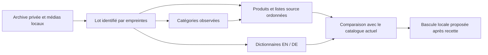

# HOMYA — plan d'import contrôlé vers MariaDB XAMPP

Version 0.2 — **7 octobre 2026 — plan et MCD validés, statut documentaire actualisé après confirmation**. Conception et préparation documentaire uniquement. Aucun importeur, schéma SQL, migration, base, compte ou changement de configuration créé. La validation de ce plan et du modèle ne vaut pas autorisation d'exécuter une migration.

## 1. Périmètre et décisions

**Décisions validées :** projet `/Users/akm/Documents/ChatGPT/HOMYA`, Laravel, cible MariaDB XAMPP ; catalogue consultable FR/EN/DE, prix EUR, source autorisée et provenance conservée. Registre unique : [Specification, section HOMYA](/Users/akm/Codex-Workspace/specification/references/DECISION-AND-CHANGE-LOG.md). La demande actuelle porte uniquement sur revue et préparation.

**Conception validée, exécution non autorisée :** importer un instantané d'archive **non vendable**, en conservant tous les produits et les signalements. Aucune sélection arbitraire de la « bonne » caractéristique, conversion d'unité, stock à zéro, héritage de prix variante ou suppression des données manquantes. L'application continuera de lire les fichiers tant qu'une bascule séparée n'est pas validée et testée.

**Exclus de ce premier import :** clients, utilisateurs, commandes, paiements, avis, stock, règles fiscales, promotions opérationnelles, livraison, emails et tracking. Les anciens prix sont des observations archivées, pas des promotions activées. Les migrations standard Laravel existantes (users/sessions/cache/jobs) et `DatabaseSeeder`, qui crée un utilisateur de test, ne doivent pas être lancés automatiquement pour le catalogue.

## 2. Environnement observé et points ouverts

| Élément | Fait / statut / preuve |
|---|---|
| PHP Laravel | CLI Homebrew 8.5.11, extension `pdo_mysql` présente ; PHP XAMPP 8.2 incompatible avec le minimum PHP 8.3 du projet |
| Serveur XAMPP | phpMyAdmin rechargé affiche MariaDB **10.4.28**, connexion par socket local, charset utf8mb4 ; socket attendu présent et de type socket |
| Connexion applicative | `php artisan homya:db-check` refuse avant SQL : accès locaux non renseignés. Aucune connexion Laravel vérifiée |
| Noms de bases retenus sous réserve | `homya_local` pour le catalogue local et `homya_test` pour la recette ; **validés sous réserve de collision**. Non visibles dans la navigation phpMyAdmin consultée ; un contrôle SQL de collision reste nécessaire avant création |
| Port / autre serveur | Cible 3307 et socket XAMPP, selon DECISION-008 ; ne jamais substituer le service Homebrew sur 3306. Le port TCP n'a pas été revalidé par SELECT dans cette phase |
| Droits / configuration | Compte applicatif et compte de création/migration à définir séparément ; `.env` privé, aucune valeur sensible demandée ou affichée |
| Sauvegarde base / restauration | **Non vérifiées**. Les sauvegardes de configuration XAMPP antérieures ne sauvegardent pas une base HOMYA |

[Observation expurgée](/Users/akm/Documents/ChatGPT/HOMYA/output/qa-import/xampp-observation.json), [environnement initial et correction XAMPP](/Users/akm/Documents/ChatGPT/HOMYA/docs/ENVIRONNEMENT-LOCAL.md). L'ouverture de phpMyAdmin atteste son accès propre ; elle ne certifie pas les privilèges de l'application ou l'absence de toute collision.

## 3. Données et source de vérité du lot

| Ensemble | Volume observé / contenu | Règle proposée |
|---|---|---|
| Produits / catégories | 3 709 produits, 65 catégories, cinq univers | Conserver slugs, références, noms, catégorie, univers, état et date de collecte exacts ; identité publique HOMYA via projection actuelle |
| Montants | Entiers positifs EUR ; maximum observé 790 758 centimes | Conserver montants et ancien prix comme instantané, sans float ni calcul fiscal implicite |
| Caractéristiques | 41 977 lignes | Tableau ordonné, sans contrainte d'unicité sur le libellé et sans conversion en objet clé/valeur qui écraserait les répétitions |
| Variantes | 92 entrées pour 26 produits | Archiver tableaux complets, valeurs inconnues absentes ; modèle des unités vendables reporté à une phase métier |
| Dictionnaires | 11 939 entrées EN et 11 939 DE ; 11 927 textes utilisés | Conserver les **23 878 entrées**, y compris les entrées actuellement inutilisées. FR provient des données source et de la projection actuelle |
| Galeries et remplacements | 18 454 associations originales ; 35 correspondances de remplacement | Conserver ordre, références locales, provenance et masquages ; fichiers image gardés sur disque, pas en BLOB SQL |
| Signalements | 627 lignes / 479 produits ; flags initiaux conservés | Importer l'archive avec ses flags ; rapport de revue distinct, aucun flag automatiquement considéré résolu |
| Capsule d'import | Index, produits, dictionnaires, métadonnées et overlay médias | Empreintes de tous les fichiers ; référencer les binaires médias et vérifier leur présence/empreinte avant et après import |

[Synthèse de revue](/Users/akm/Documents/ChatGPT/HOMYA/output/qa-import/synthese.json). JSON produit maximal observé : **8 857 octets**, sans les binaires. Cette mesure ne préjuge pas de la taille d'une future offre ni d'une limite serveur ; `max_allowed_packet`, charset, collation et mode SQL sont à lire sur la cible lors de la recette autorisée.

Les fichiers privés constituent la source de cette reprise unique, pas une synchronisation fournisseur. Une mise à jour future devra distinguer les observations source des corrections HOMYA validées pour éviter leur écrasement.

## 4. Modèle conceptuel validé — DECISION-017

Le modèle décrit l'archive consultative, pas l'ensemble du commerce. Propriétaire métier : exploitant HOMYA, identité à confirmer ; propriétaires techniques : Database Engineering pour modèle/intégrité, Development pour l'implémentation, Quality pour la recette et Security pour les accès.

| Concept | Identifiant proposé / contenu | Association et origine | Statut / cycle de vie |
|---|---|---|---|
| Lot d'archive | Empreinte du manifeste + version du format ; date, volumes, provenance, preuves de validation et overlay médias privé | Une capture cohérente regroupe ses produits, catégories et dictionnaires | Proposition ; préparation puis vérification technique avant sélection ; aucune purge/rétention fixée |
| Catégorie observée | Slug dans le lot ; nom source | Chaque produit de cet instantané possède exactement une catégorie ; 65 catégories utilisées | Cardinalité observée, sans imposer une seule catégorie au futur catalogue commercial |
| Produit observé | Slug dans le lot ; référence, métadonnées, montants et contenu source complet | Un produit appartient à un lot et une catégorie ; descriptions/caractéristiques/variantes/galeries contenues et ordonnées | Snapshot proposé ; aucun état de vente ou suppression automatique |
| Entrée de traduction | Lot + langue + texte source exact ; texte traduit et métadonnées du dictionnaire | Dictionnaire partagé par plusieurs textes et produits ; EN/DE existants, aucune ligne FR générée artificiellement | Proposition ; corrections linguistiques nécessitent revue et nouvel instantané tracé |



**Choix proportionné recommandé :** quatre relations logiques pressenties (lot, catégories, produits, dictionnaires). Les tableaux de caractéristiques, variantes et galeries restent dans le document produit, car les recherches actuelles ne filtrent pas leurs éléments individuellement. Cela évite d'inventer dès maintenant les entités de stock/unité vendable.

### Relations conceptuelles approuvées

Les cardinalités concernent **un lot complet et vérifié de cette archive**. Pendant le chargement technique, un lot incomplet ne peut pas être sélectionné par l'application. Elles ne définissent pas le futur modèle commercial de vente.

| Relation | Cardinalités proposées | Justification et limite |
|---|---|---|
| Lot — Produit observé | Un lot vérifié contient 1..N produits ; chaque produit observé appartient à exactement un lot | Reprise des 3 709 fiches de l'instantané ; le même slug peut exister dans plusieurs lots sans écrasement |
| Lot — Catégorie observée | Un lot vérifié contient 1..N catégories ; chaque catégorie observée appartient à exactement un lot | Catégories dérivées des produits du lot, 65 dans la capture actuelle |
| Catégorie observée — Produit observé | Une catégorie dérivée contient 1..N produits ; un produit observé a exactement une catégorie du même lot | Lecture vérifiée des 3 709 fiches ; catégories avec 1 à 1 085 produits. Ne contraint pas une future offre commerciale à une seule catégorie |
| Lot — Entrée de traduction | Un lot vérifié possède 1..N entrées ; une entrée appartient à un lot et une langue EN ou DE | 23 878 entrées conservées ; les contenus français restent dans les sources et la projection existante |

**Identifiants conceptuels proposés :** lot par empreinte de capsule/version ; produit et catégorie par lot/slug ; traduction par lot/langue/texte source exact. Une empreinte utilisée comme clé technique devra être confrontée au texte exact ; les clés physiques restent à préciser dans le MLD. Les références produit restent des attributs conservés, sans règle d'unicité globale inventée.

**Contenu et cycle de vie :** le lot conserve les métadonnées complètes d'index/inventaire/dictionnaires, la provenance, les remplacements médias et la capsule de revue ; le produit conserve son document source complet et toutes ses listes ordonnées. Un nouveau lot ne modifie pas un lot déjà vérifié. Aucune purge, rétention ou suppression automatique n'est approuvée. Toute correction métier ou linguistique doit rester traçable à sa source et donner lieu à une version identifiable.

**Alternative :** normaliser immédiatement caractéristiques, variantes, médias et unités en relations distinctes. À préférer seulement lorsque filtres structurés, édition métier, stock ou achat par variante sont validés. Plus de contraintes et migrations, sans résoudre les règles métier absentes. Un JSON monolithique de tout le catalogue simplifierait trop peu les requêtes et isolerait moins bien les erreurs : non recommandé.

**MLD approuvé :** [modèle logique v0.2](/Users/akm/Documents/ChatGPT/HOMYA/docs/MODELE-LOGIQUE-ARCHIVE-HOMYA.md), DECISION-018. [Plan technique proposé](/Users/akm/Documents/ChatGPT/HOMYA/docs/PLAN-TECHNIQUE-ARCHIVE-XAMPP.md), types physiques et capacités restent à valider/vérifier. Aucune table ni migration implémentée. Les mentions « proposition » dans les descriptions ci-dessus retracent la conception soumise puis approuvée, sans valoir exécution.

## 5. Contraintes et requêtes à spécifier dans le MLD

- Identité stable par lot/slug ; catégorie du même lot ; dictionnaire par lot/langue/clé source. Une clé dérivée par SHA-256 peut éviter l'indexation de longs textes, avec comparaison du texte exact et refus d'une collision ; choix à confirmer dans le MLD.
- Conserver références et casse exacte sans unicité commerciale globale déduite du seul instantané. Rejeter les clés JSON dupliquées avant import, les slugs impropres, champs critiques invalides ou index/détail divergents. Prix en entiers suffisamment dimensionnés selon les bornes validées ; valeurs commerciales inconnues restent absentes ou nulles, jamais zéro.
- Requêtes observées : produit par slug ; catégories/univers/marque/état ; prix min/max, tri prix et nom, départage stable par slug ; recherche accent-insensible ; pagination de 24 conservée. Index identité et catégorie justifiés ; index complémentaires à mesurer avec les requêtes réelles sur MariaDB avant de les ajouter.
- La collation SQL peut produire un ordre différent du tri PHP actuel. Recommander une première lecture SQL qui alimente **la projection et le filtrage existants**, puis optimiser seulement après comparaison. Ne pas promettre qu'un `LIKE` ou tri SQL reproduit `Str::ascii` / `strnatcasecmp` sans tests FR/EN/DE.
- Contraintes référentielles restrictives recommandées pour éviter une suppression en cascade involontaire. Aucun effacement automatique de lot, soft delete, durée de conservation ou purge inventé. Les snapshots précédents restent disponibles jusqu'à décision explicite de rétention.
- Contenu privé/provenance hors HTML ; ne jamais retourner directement les payloads SQL dans un contrôleur public. Réutiliser les règles HOMYA, langue sélectionnée, alt localisé, sélection de photo et masquage des 153 descriptifs.

## 6. Séquence d'import futur et autorisations séparées

Toutes les étapes d'écriture ci-dessous sont **proposées, non exécutées**. Aucun exemple de commande destructive ou migration prête à lancer n'est fourni dans cette phase.

| Étape | Action future / conditions | Contrôle de sortie observable |
|---|---|---|
| IMP-01 — Valider le périmètre | Accepter archive locale non vendable, conservation des flags et modèle conceptuel ; établir le MLD | Version et portée approuvées dans le registre central ; inconnues métier laissées ouvertes |
| IMP-02 — Identifier la cible | Lecture ciblée de version, socket, répertoire XAMPP, port, schémas candidats, moteur, charset/mode SQL et droits | Cible XAMPP confirmée ; collisions vérifiées en lecture seule, aucun accès implicite Homebrew/SQLite |
| IMP-03 — Préparer l'isolation | Plan précis des bases locale/test, comptes et privilèges ; autorisation explicite distincte avant création/configuration | Bases et comptes autorisés et isolés ; compte applicatif sans création/suppression de schéma ; secrets saisis localement hors chat |
| IMP-04 — Sauvegarder | Capsule source + binaires médias référencés ; sauvegarde cohérente de toute cible existante avant mutation ; essai de restauration isolée autorisé séparément | Empreintes concordantes et preuve de restauration ; absence de sauvegarde éprouvée bloque toute modification d'une cible existante |
| IMP-05 — Implémenter le lot | Autorisation de code et migrations utiles au seul MLD du catalogue ; validation sur `homya_test` confirmé | Aucun utilisateur de test ni table commerce créé par défaut ; contraintes réelles exercées sur MariaDB, pas seulement SQLite |
| IMP-06 — Simuler intégralement | Importeur en lecture seule par défaut ; contrôle de tous les fichiers, clés, volumes, chemins médias, modèle/ref et dictionnaires | Rapport créer/modifier/refuser, zéro écriture pendant simulation ; aucune correction ou collecte réseau implicite |
| IMP-07 — Charger isolément | Autorisation spécifique d'import ; lot non actif, écritures paramétrées et transactions de données InnoDB ; journal borné et expurgé | Rien de partiel visible ; échec identifiable ; une reprise du même instantané ne double pas les produits/variantes/galeries |
| IMP-08 — Rapprocher | Comparer archive et lecture SQL, tableau par tableau, ordre et champs exacts | 3 709 produits, 65 catégories, 41 977 caractéristiques, 92 variantes, 18 454 associations source, 23 878 traductions et 35 overlays conservés ; 627 signalements conservés dans la capsule de revue |
| IMP-09 — Recetter la projection | Mêmes tests de recherche/filtres/tri/pages, montants, fiche FR/EN/DE, langues manquantes, 404/503 et masquages | Aucune différence non acceptée ; cartes/fiches avec photo, provenance privée exclue ; changements de langue gardent le contexte |
| IMP-10 — Basculer explicitement | Autorisation séparée de sélectionner le lot SQL en local après recette ; conserver la lecture fichiers disponible | Retour à l'archive sans suppression SQL ; lot précédent non modifié. Aucune ouverture de vente ou publication |

**Gestion d'échec et idempotence proposées :** l'empreinte/version identifie l'instantané ; le même lot vérifié n'est pas recréé. Un nouveau lot est chargé sans écraser le lot sélectionné. Une transaction de données échouée est annulée sur le moteur transactionnel ; une interruption par lots reste marquée incomplète et doit être rapprochée avant reprise. Aucun `INSERT IGNORE` ni écrasement silencieux pour masquer une violation. Les champs et fichiers anormaux sont conservés pour revue ; une erreur de structure empêche l'application du lot.

**Retour arrière :** la première bascule ne fait que changer la source de lecture, selon mécanisme à implémenter/valider ; les fichiers restent inchangés. Le retour fichiers ne retire pas automatiquement les données SQL. Une migration DDL peut provoquer un commit implicite : aucun rollback global de schéma/données n'est promis ; restauration et compatibilité sont des contrôles distincts.

## 7. Sécurité, qualité et exigences

**Frontières examinées :** archive/source non pleinement validée → importeur → base privée → projection publique. Risques : mauvaise cible, écrasement de corrections, perte des valeurs répétées, fausse disponibilité, exposition de provenance ou secret, lot partiel, double import. Ce sont des risques de conception, pas des vulnérabilités exploitées ou certifiées.

Mesures proposées : liste de fichiers attendus et chemins bornés ; aucune résolution arbitraire d'URL ; clés JSON uniques ; compte import borné au schéma confirmé ; requêtes paramétrées ; aucun secret en argument/journal ; binaires privés séparés de la racine web ; simulation par défaut et confirmation explicite des écritures ; validation locale du serveur avant toute mutation. Classification des données : catalogue publiable par projection, provenance/déclarations et preuves internes privées, configuration sensible privée ; aucun client ou paiement inclus.

| Exigences du CDC | Critère pour le futur lot SQL | Statut actuel |
|---|---|---|
| REQ-001/005/006 | Tous rayons/produits accessibles, recherche et fiches conservées, valeurs divergentes tracées | Archive revue ; import et équivalence SQL À vérifier |
| REQ-003/004 | Texte de langue sélectionnée, même contexte, photos/alt et responsive conservés | Dictionnaires couverts ; relecture technique ouverte ; recette SQL future |
| REQ-007/009/010 | Variantes, prix vendables, unités et stock contrôlés selon règles confirmées | Bloquants pour achat ; aucun achat dans ce lot d'archive |
| REQ-025/029 | Cible et droits bornés, secrets protégés, sauvegarde/restauration isolée | Plan proposé ; droits et restauration non vérifiés |
| REQ-030/034 | MariaDB XAMPP réel, contraintes et non-régression mesurées | Serveur observé ; accès Laravel absent ; tests SQL non réalisés |
| REQ-033 | Droits et données techniques nécessaires revus avant publication | Déclarations/sources existantes ; justificatifs et revue métier ouverts |

Le CDC attribue REQ-035 aux promotions/avis : aucune fonctionnalité de ce type dans ce lot. Les références de la présente recette suivent les libellés du CDC canonique.

## 8. Questions techniques externes vérifiées

Consultation effective **07/10/2026**, sources primaires. Questions : Laravel 13 supporte-t-il cette famille MariaDB ? JSON MariaDB est-il équivalent à JSON MySQL ? Le DDL s'annule-t-il dans la transaction d'import ? Cette version MariaDB est-elle maintenue ?

| Titre / URL | Portée / fait publié | Interprétation et limite pour HOMYA |
|---|---|---|
| [Database: Getting Started — Laravel 13](https://laravel.com/framework/docs/13.x/database) | Documentation version 13 ; support annoncé MariaDB 10.3+ | 10.4 appartient à la famille supportée ; cela ne prouve ni connexion, contraintes réelles ni maintenance du moteur local |
| [JSON — MariaDB Server](https://mariadb.com/docs/server/reference/data-types/string-data-types/json) | Documentation actuelle, date de version non indiquée ; JSON est un alias LONGTEXT, validation JSON et différence de stockage avec MySQL | Valider JSON et tableaux ordonnés ; comportement des contraintes à éprouver sur 10.4.28. Ne pas assimiler MySQL/MariaDB ni déduire la performance |
| [SQL statements causing an implicit commit — MariaDB](https://mariadb.com/docs/server/reference/sql-statements/transactions/sql-statements-that-cause-an-implicit-commit) | Documentation actuelle, date de version non indiquée ; CREATE/ALTER et d'autres opérations entraînent un commit implicite | Séparer migrations DDL et import transactionnel de données ; aucun rollback global promis |
| [About MariaDB Server — maintenance policy](https://mariadb.org/about/#maintenance-policy) | Tableau officiel ; fin de maintenance communautaire 10.4 au **18/06/2024** | Risque d'environnement existant à tracer ; usage local non exposé. Évolution vers un moteur maintenu à planifier avant données réelles/production, sans modifier XAMPP dans cette phase |

Ces vérifications ne choisissent pas un hébergeur ni n'autorisent une mise à niveau. Hébergement, production et services Google restent hors périmètre.

## 9. Livrables, vérifications et arbitrages

Fichiers ajoutés : [revue détaillée](/Users/akm/Documents/ChatGPT/HOMYA/docs/REVUE-DONNEES-CATALOGUE.md), ce plan, `scripts/review_catalogue_import.py`, ses quatre tests synthétiques et rapports `output/qa-import/`. README complété avec les liens. Le script n'a aucune connexion SQL ou réseau et écrit uniquement ses rapports ; une nouvelle exécution régénère ces rapports, pas les sources.

```sh
PYTHONDONTWRITEBYTECODE=1 python3 scripts/test_review_catalogue_import.py
PYTHONDONTWRITEBYTECODE=1 python3 scripts/review_catalogue_import.py
python3 scripts/verify_catalogue.py
python3 scripts/verify_catalogue_localizations.py
php artisan homya:db-check
```

Le dernier diagnostic est en lecture seule et refuse actuellement les accès non renseignés. Aucun mot de passe ou jeton n'est fourni par ces commandes.

**Réellement vérifié :** tests de revue, structure du catalogue, dictionnaires/protection des codes et nombres, cohérence des index/montants, 3 714 empreintes source avant/après génération, socket/PDO, refus contrôlé du diagnostic et observation phpMyAdmin. Aucun code applicatif changé ; build/navigateur HOMYA et PHPUnit non relancés. Aucun test de contrainte, import, sauvegarde/restauration ou connexion applicative MariaDB déclaré réussi.

**Arbitrages structurants restants :** (A) approuver les choix physiques et le plan technique ; (B) vérifier les collisions des noms retenus ; (C) définir les comptes/droits localement et présenter le plan de création/migrations avant autorisation propre à ces écritures. Le périmètre d'archive, le MCD et le MLD sont approuvés. Les prix/stock/vente peuvent rester inconnus tant que l'import porte uniquement sur l'archive.

**État de sortie actualisé :** plan v0.2 et MCD validés dans DECISION-017 ; MLD v0.2 validé dans DECISION-018, import non commencé. Blocages d'exécution : types physiques non validés, accès applicatifs absents, collisions et sauvegarde/restauration non vérifiées, autorisations d'écriture non reçues.

## 10. Revue technique de la version 0.2 et portée d'approbation

**Revue effectuée :** plan relu, exigences et limites des modules Database Engineering/Specification rapprochées, volumes comparés à la synthèse, cardinalités vérifiées sur toutes les fiches et empreintes des 3 714 sources recontrôlées sans différence. Les quatre concepts satisfont la conservation de l'archive et les usages consultatifs décrits ; les règles d'achat absentes restent hors du modèle. Pas de nouvelle recette SQL ou vérification commerciale effectuée.

**Conclusion technique :** proposition cohérente, prête à soumettre à l'approbateur HOMYA pour ce seul périmètre. Ce constat n'est ni une approbation métier reçue, ni une preuve de schéma exécuté. Le MLD reste à rédiger après validation du MCD.

| Critère d'approbation du modèle | Décision précise proposée | Vérification future liée |
|---|---|---|
| MOD-01 — Conservation | Reprendre les 3 709 produits et les 627 signalements, sans arbitrage automatique des caractéristiques ou suppression des 479 fiches à relire | Comparaison exhaustive des champs et tableaux ordonnés, contrôle IMP-08 |
| MOD-02 — Périmètre consultatif | Montants comme observations EUR ; aucune fonction d'achat, stock inventé ou héritage de prix des variantes | Absence des objets commerce exclus et recette de projection IMP-09 |
| MOD-03 — Modèle conceptuel | Quatre concepts et relations de la section 4 ; documents produit complets, listes et métadonnées conservés, médias sur disque | MLD à dériver puis à approuver ; contraintes et pertes de données à vérifier sur MariaDB |
| MOD-04 — Langues et identité | Dictionnaires EN/DE complets, FR source ; projection HOMYA et masquages existants conservés | Comparaison FR/EN/DE, sans exposition de provenance privée ; relecture sémantique toujours ouverte |
| MOD-05 — Isolation | Noms prévus `homya_local` / `homya_test`, sous réserve de collision ; source fichiers maintenue jusqu'à bascule approuvée | Contrôles IMP-02/03/09/10 avant leurs écritures respectives |
| MOD-06 — Autorité | Approuver le plan v0.2 et le MCD permet la préparation documentaire du MLD ; aucune création/migration/import/bascule autorisé par cette approbation | Autorisations séparées à présenter avec fichiers/opérations exacts après modèle logique et contrôles de cible |

**Approbation reçue :** utilisateur HOMYA, le 7 octobre 2026 : « Valider le plan v0.2 et le modèle conceptuel », en réponse à la question reprenant les quatre concepts, la conservation complète, les bases sous réserve de collision et la portée documentaire. **Statut : VALIDÉ — DECISION-017**, enregistré puis relu dans le registre central unique. Cette approbation permet la préparation documentaire du MLD, pas son approbation ni une écriture SQL.

**Traçabilité de la version soumise :** SHA-256 `b95fd068c3fbd007d30d3a96a5deccef264a28bdb6bd8583658cf355ee5faa1e` avant cette actualisation de statut. Copie exacte sauvegardée dans `/private/tmp/homya-avant-validation-017-yt_xvyng/PLAN-IMPORT-XAMPP-v0.2-approuve.md`. Les modifications présentes consignent la validation et le lien au MLD, sans changement de périmètre ou de cardinalité.
